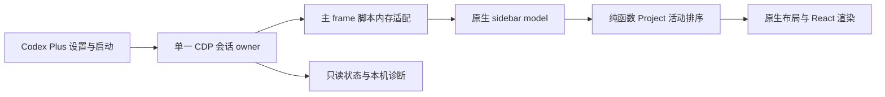

# Project 按任务更新自动排序

## 2026-11-14 状态优先修复（当前排序合同）

原实现仅以活动时间排列项目，项目内聊天沿用原生顺序，导致较新的闲置任务穿插在旧的进行中任务前面。当前在同一已审核模型接缝中使用原生 `qM` 状态：输入／批准／错误优先，其次 active、unread、idle／未知。项目取全组最高任务优先级，同类仍按活动时间排列；缺少时钟的项目只在同类内保留原槽位。项目内任务按相同优先级稳定分组，同类保留原生排序设置。投影返回原生模型后才生成预览和导航，保留任务身份，不改原生项目或任务持久化顺序。Pinned 与自定义分区继续沿原生路径。

排序协议为 7。升级后既有协议 6 页面显示需要重新接入；沿设置页现有“重新接入页面增强”入口检查未提交内容，再更新页面，且同时验证排序、布局和后台建议三项协议，不把仅安装新版当成排序已经生效。退出 Plus 后已执行投影保留到页面重载，正常重载且无 Plus 接入时恢复原生行为。原活动 ledger 与窗口布局记录继续复用。

日期：2026-11-10。Owner：Longbiao；方案与实现责任：Codex Plus 当前任务。
状态：阶段 A 已完成真实宿主验收，结论为未通过。双窗口可见前台排序、原生导航、草稿数据保留和正常重启回退已验证；后台完成置顶及 reload 自动恢复选中聊天未通过。自动排序未进入安装版，阶段 B 未启动。见[评审报告](../reviews/project-activity-order-egm.md)。

## 目标与行为

Projects 区域按每个项目中最近更新的任务自动排序。任务继续执行、完成、报错或需要用户输入时，随着原生任务更新信息变化，其所属项目自动前移。用户通过 Codex Plus 选择“任务最近更新”或“原生手动顺序”。运行状态使用相同的时间排序规则。

- 项目活动时间取其所属有效任务的原生 Last updated 有效时间的最大值；时间单位统一为 epoch 毫秒。原生适配当前使用 `recencyAt ?? updatedAt`，云任务秒时间转毫秒，ChatGPT 时间字符串使用原生解析规则。
- 相同时间按原生手动顺序稳定排列；空项目活动时间为 0。原生尚未提供元数据的项目使用最后有效值；首次未知项目固定在原生顺序的槽位，已知项目排序后填入其余槽位，同时报告覆盖缺口。例：原生 A/B/C，B 首次未知、C 最新，显示 C/B/A；B 元数据恢复后按其源时间参与全体排序。接收时间仅作诊断。
- 自动排序作用于默认 Projects 区域，保留 Pinned 和自定义分区的位置、归属与内部顺序。项目内聊天沿用原生设置；Codex、远程 Codex 和 ChatGPT 项目使用来源前缀与项目 ID 组成身份。
- 保留项目展开、选中、菜单、快捷键和滚动锚点。发生拖动、菜单操作或键盘导航时暂存新排序，交互结束后一次应用。自动模式下手动拖动可调整相同活动时间项目的基准顺序；下一次活动变化仍按时间排序。
- 设置标明“下次正常启动生效”。模式在一次进程会话内固定，切换模式通过正常退出和启动完成；已有工作区自动展开设置独立生效。

可观察示例：A、B、C 的原生顺序为 A/B/C；B 的任务时间最新时显示 B/A/C；C 的后台任务随后产生更新，显示 C/B/A；切回手动模式并正常启动，恢复原生顺序及用户后来作出的手动调整。

## 当前实证

本机源码基线为 `3d49969`，Codex Plus 安装版 0.2.0。宿主为 `/Applications/ChatGPT.app`，bundle ID `com.openai.codex`，版本 26.1103.60933。本轮按只读数据方式检查宿主安装包中的 `app.asar`，保存的代码摘录仅位于本机缓存。

1. 界面使用 React/Rspack。`webview/assets/async/499225.6d2e47bea2.js` 消费 `projectOrder`、项目分组和布局。
2. `182735.7f13786b92.js` 的 sidebar model（本版本模块 `DZgh`）先按 `PROJECT_ORDER` 排列项目组，再按原生时间排列组内任务，然后构建布局。模块 `r6TF` 提供有效任务时间，部分分支优先使用 `recencyAt`。这些名称用于本次定位，适配器按结构发现。
3. 同一资源中的项目服务存在 `projectPresentation.readOrder()`、`projects.setProjectOrder()`，原生 setter 还带 query cache 的乐观更新与失败恢复。这说明界面具备顺序状态和操作链；运行时可达性仍待实测。
4. 官方 `list_threads` 回读 `sorting.projects=updated_at`；`update_sidebar_preferences` 的 schema 将 projects 定义为 chats 的别名。安装版“Sort chats by → Last updated”已选中。这一设置控制项目内聊天。
5. 官方 `reorder_sidebar_projects` 提供单次顺序写入。当前公开 app-server schema 包含 `thread/list`，缺少项目排序方法。

Web renderer 提供可研究的接缝。当前已确认结构与候选接缝，CDP 接入及内存适配属于待验证能力。

## 参考项目与采用范围

| 项目、固定候选 | 已读代码与发现 | 本项目采用的设计经验 |
| --- | --- | --- |
| [qqheling/codexplusplus，a114ae5](https://github.com/qqheling/codexplusplus/tree/a114ae5ca7a6ca4e798482fc943848df0ccffabb) | `crates/codex-plus-core/src/cdp.rs` 发现 loopback CDP target；`launcher.rs` 添加调试参数并连接 renderer；`assets/inject/renderer-inject.js` 注入界面行为并按资源链接动态导入模块 | 外部 helper 管理连接和注入；本机当前 Rspack 资源结构与其示例 ESM 文件名有差异，重新适配 |
| [b-nnett/codex-plusplus，13d0c24](https://github.com/b-nnett/codex-plusplus/tree/13d0c2421cc4258565710910ca8dfe60344c027e) | `SidebarAdapter.swift`、`Resources/sidebar-adapter.js`、`shell-adapter.js`、`renderer-runtime.js`、`extensions/better-sidebar`：AST 结构发现、版本化能力接口、清理生命周期；当前主线采用签名 bundle patch 与 Electron 内进程执行 | 结构发现需独立佐证；适配失败给出原因；实例初始化幂等并登记清理。其签名替换和全套扩展系统维护成本单列比较 |
| [qoli/codex-disable-escape-tweak，241f066](https://github.com/qoli/codex-disable-escape-tweak/blob/241f066ab315c98ff1df15a884f50d72328c8630/index.js) | 小型 tweak 的 start/stop 对称注册和移除事件监听 | 单功能包、完整释放监听，控制实现范围 |

以上代码通过 GitHub 官方连接器读取，以固定提交源链接作为跨环境复核正本，详见[来源记录](../research/project-order-sources.md)。研究源码缓存属于本机可丢弃资源，评审环境按固定链接自行读取。当前仅参考设计；代码复用前核对应文件许可证及依赖。b-nnett 本次读取的 LICENSE 为 MIT；本轮未复制其实现到产品源码。

## 方案比较与推荐

| 路径 | 接入和维护成本 | 决定 |
| --- | --- | --- |
| 外部 helper＋CDP＋内存 renderer 适配 | 保留供应商安装包和签名，需正常重启宿主启用 CDP；须验证 app:// 脚本响应拦截、CSP、启动时序和数据覆盖 | 推荐先做有明确通过条件的可行性原型 |
| 签名 bundle patch＋内进程扩展 | b-nnett 源码提供成熟思路；涉及 ASAR 完整性、重新签名、Keychain 分区、Computer Use 认证和每次升级恢复 | 作为后续需独立决定的架构选项；本方案阶段保持原安装包 |
| AX/DOM 行移动或 CSS order | 可以处理可见节点；React reconciliation、虚拟化和键盘顺序另需修复，折叠项目的数据覆盖较弱 | 更适合表层外观调整；当前排序需求采用模型接缝 |
| 周期性调用排序工具／模型任务 | 工具可单次写顺序；常驻 native app 缺少同等公开入口，轮询还产生调度与模型成本 | 保留为人工管理入口 |

推荐路径的完整功能实施以原型通过为前提。原型失败后记录精确缺口并修订方案，再决定接入路径。

## 推荐架构



### 接入

由现有 Swift app 持有 `URLSessionWebSocketTask` CDP client，保留当前 AX 自动展开模块。只接入已核验供应商签名和 bundle ID 的目标进程；新功能一次仅一个连接 owner，逐个处理主窗口的受信任顶层 frame。

正常启动时使用 Electron `--remote-debugging-port`；端口由系统分配，实际绑定须为 loopback，连接必须核对端口所属宿主进程。顶层 URL 必须精确匹配 `app://-/index.html`，普通网页、内嵌浏览器、子 frame 和其他调试目标各自保持原行为。原型先验证该版本的实际启动参数、端点定位及 frame 识别，候选失败时保持功能关闭并显示具体原因。

CDP 具有完整 renderer 调试能力；loopback 与随机端口提供暴露范围控制，同机进程仍具备连接机会。首次启用界面说明该能力、启动方式与停用方式。调试端点随宿主进程存续，关闭 helper 后仍需正常退出宿主才能关闭监听；以 OS listener 回读作为回退验收。实际启用属于后续实施和运行验收，本轮保持现有进程及启动参数。

### 内存适配与排序位置

候选机制：通过 CDP `Fetch.enable` 在 Script 的 Response 阶段拦截受信任主 frame 的 sidebar model 资源，读取源码，以 AST 识别 sidebar builder，在原生组内排序之后、布局及快捷键列表生成之前插入一处纯函数调用，再用 `Fetch.fulfillRequest` 返回内存副本。资源 URL 从主页面导入图发现，匹配身份、内容结构和调用证据。磁盘 ASAR 保持原字节。

适配器必须验证项目分组、任务键、原生时间解析与布局消费者属于同一数据链；每一必需接缝唯一匹配才激活。阶段 A 真实宿主仅支持文末固定资源路径与源码摘要；局部变量重命名用例只证明 fixture 的结构适配能力。AST 改写后重解析；缺失、多义或版本变化时放行原始响应并显示 unsupported。调试器断连时被暂停请求的实际处理行为列入原型与故障验收。

排序逻辑在应用原生响应式模型内执行，取项目全组 `threadKeys` 的有效任务时间最大值，并以传入原生项目组顺序作为稳定次序；投影同时被布局、渲染、键盘和导航消费者使用。原生持久化顺序继续由原生手动操作管理，自动排序在内存中产生投影。Pinned、自定义分区和项目内聊天设置保留其原生数据链。

任务数据使用宿主已有的摘要／catalog／状态更新依赖。状态变化依照原生有效更新时间触发；同一时间和重复事件保持幂等。首屏、折叠项目、后台更新、远程 host 和 ChatGPT 项目都要核对分组覆盖。原型必须发现所有默认 Projects 来源的模型接缝；任一来源缺失时不将该范围标为已支持。

已加载分组不足以给出所有项目的最新值时，优先接入原生摘要/catalog 的现有查询。每个项目的最近任务摘要足以完成排序；全历史正文和私有数据库均无需加入该数据流。断开的来源保留最后有效值，状态给出 stale；重连后使用源时间重新计算。

### 运行生命周期与恢复

- 当前宿主已运行且没有 CDP 时，显示“下次从 Codex Plus 正常启动后生效”；保留进行中的任务和窗口。
- 原型必须覆盖启动期间脚本可能先于 CDP attach 加载的竞态。候选恢复方式是完成连接与拦截安装后的一次主 frame reload；只在正常启动验收场景执行，并验证任务、草稿、选中项和标签页恢复。恢复检查失败则当前接入候选失败。
- 新窗口、renderer reload 和 crash 后按目标身份重建单实例；每个主 frame 使用会话 generation，过期异步返回丢弃。多窗口共用固定排序模式和原生顺序基准。
- 手动模式的正常启动完全使用原始脚本；自动模式出错优先放行原始脚本。已执行的脚本通过正常重启恢复，界面准确显示“重启后停用”。
- 宿主升级后先以结构适配和原型回归验证新版本；失配时显示 unsupported，现有 AX 功能独立运行。
- 状态只报告模式、版本、连接、适配命中、项目覆盖数、stale 来源数及最近错误码；聊天正文、任务标题、项目路径和 debugger endpoint 从诊断输出省略。

## 实施阶段与文件范围

### A：可行性原型

本方案下一实施单元仅覆盖 A；B 的结构已给出，A 的证据决定其接口定稿。

阶段 A 的新增文件固定为：

- `tools/project-order-probe/package.json`、`tools/project-order-probe/package-lock.json`：私有开发工具包；Node 最低版本 22.4.0，当前采集版本 26.13.0；精确依赖 Acorn 8.15.0、Electron 45.2.3，使用 npm lockfile v3。安装和 Electron 下载缓存均指向 `~/Library/Caches/codex-plus/`；node_modules 在该缓存的独立工具运行目录，源码仓仅保存清单和锁文件。实施时用 package-lock-only 生成并提交真实 lockfile，再在缓存副本执行 npm ci。
- `scripts/inspect-sidebar-model.mjs`：入口参数 `--app` 与 `--out`；只读 ASAR，输出宿主身份、导入图、模型候选及覆盖来源；Acorn 以缓存工具目录的绝对模块 URL 加载。零/多匹配作为 unsupported 写入报告。
- `scripts/probe-project-order.mjs`：入口参数 `--mode fixture|host`、`--scenario`、`--out`；host 模式另需 `--app` 和 `--enable-host-debugging`。只启用的宿主允许启动 CDP；程序检查宿主已正常退出，否则记录 waiting-for-normal-exit 并返回。fixture 模式启动自有测试载体。
- `Tests/Fixtures/ProjectOrderElectron/main.cjs`、`index.html`、`sidebar-model.mjs`、`scenario-data.json`：Electron 隔离 fixture，注册 standard/secure/supportFetchAPI 的 `app` scheme，加载 `app://-/index.html`；BrowserWindow 隐藏、contextIsolation 开启、nodeIntegration 关闭。userData 与输出置于本次缓存/日志目录。数据固定三个项目、同时间/未知/恢复/来源更新序列和带序号脚本。fixture 按模型数组产生 DOM 与键盘导航序列，脚本可以延迟加载。fixture 使用 Electron 45.2.3；当前宿主使用定制的 Codex Framework（本机框架版本 157.0.8103.39），实际宿主兼容性以单独矩阵验收。

fixture 只证明受控自定义协议的 CDP 行为和投影算法。当前宿主的 React/Rspack、签名、CSP、真实数据覆盖与草稿恢复逐项在 host 阶段验证。

两个脚本的完整调用示例（供阶段 A 实施后使用）：

```sh
node scripts/inspect-sidebar-model.mjs --app /Applications/ChatGPT.app --out "$HOME/Library/Logs/codex-plus/project-order-probe-20261110/source.json"
```

```sh
node scripts/probe-project-order.mjs --mode fixture --scenario all --out "$HOME/Library/Logs/codex-plus/project-order-probe-20261110/fixture.json"
```

```sh
node scripts/probe-project-order.mjs --mode host --app /Applications/ChatGPT.app --enable-host-debugging --scenario startup --out "$HOME/Library/Logs/codex-plus/project-order-probe-20261110/host.json"
```

fixture 场景 `all` 固定包含下表；host 仅以官方 Computer Use 操作已安装版，CDP 只承担本功能接入、模型诊断及响应拦截。

| 场景 | 触发 | 观察和通过条件 | 失败后的清理 |
| --- | --- | --- | --- |
| response-disconnect | Script 响应暂停后主动关闭 CDP WebSocket；另一次正常停用 Fetch，分别记录 | 请求自然放行或由已验证的恢复步骤恢复，页面最终 loaded；正常停用须先将所有在途请求以原文完成，再 disable；绝不在 getResponseBody 未完成时 disable | 重连同一 fixture target，完成仍暂停的请求并 disable；失败则正常关闭自有 fixture，报告 candidate-failed |
| late-attach | fixture 先加载原脚本并设置序号，再 attach、开启拦截并执行一次 reload | 第一次为原始序号；reload 后为适配序号；同一数据只注册一个排序实例；随后正常重启回到原始序号 | 正常关闭 fixture，清除本次临时缓存，保留报告 |
| window-recreate | fixture 主进程创建第二窗口，销毁后重新创建；另执行一次 renderer crash 并恢复 | 每个目标只承载自身实例；generation 旧返回被丢弃；重建后序号和模型/导航次序一致 | 正常关闭 fixture 的全部窗口和进程，核对调试 listener 退出 |
| source-mismatch | 改变 fixture 候选结构为零匹配和多匹配 | 原始响应成功运行，状态为 unsupported；无半适配脚本 | 关闭 fixture，保留源匹配报告 |

host 阶段逐项记录：正常退出前以官方 Computer Use 建立带草稿与标签页的本地现场；正常退出、增强启动、必要的一次 reload 后读回；两个实际窗口及 renderer 自身重建；默认区的本地/远程/ChatGPT 来源和折叠项目后台更新；手动模式正常重启；宿主退出后的 listener。实际任务状态使用本地可逆测试任务，源码与响应诊断省略正文。任何未具备现场的来源标记 not-tested，该来源的 B 发布验收保持开放。host 的现存任务、草稿或标签页恢复失败时停止重复 reload，关闭增强模式，按正常启动恢复现场并报告失败证据。

原型产物写入 `~/Library/Logs/codex-plus/project-order-probe-<date>/`，源码摘录与解析缓存写入 Caches。必须记录：宿主版本/签名、候选身份、真实 loopback listener、主 frame URL、Script 响应可拦截性、CSP/完整性结果、脚本加载竞态、断连恢复、各来源的数据覆盖、前台/后台更新时间、键盘/导航同序、草稿/任务恢复。

A 通过条件：fixture 四类场景通过，当前安装版主来源的接缝可重复工作，窗口重建保持单实例；暂停响应在断连后按实测路径恢复，未知资源直接放行，已执行适配在正常重启后恢复原始脚本；原生任务与草稿通过保全检查。每个来源分别记录 supported / not-tested / unsupported，B 仅对已通过来源进入实施与验收。CDP 的 localhost 控制面暴露在首次启用时明确呈现。任一必需条件失败，A 交付失败证据与设计修改点，保持自动排序关闭。

### B：产品接入

通过 A 后在同一 checkout 串行实施，沿用当前构建/签名/安装链。

| 文件 | 修改内容 |
| --- | --- |
| `Sources/CodexPlusCore/CodexRendererConnection.swift` | CDP transport、请求 ID、主 frame 识别、generation、Script response 拦截与原文放行 |
| `Sources/CodexPlusCore/CodexProjectOrderPreference.swift` | 持久化 `nativeManual` / `taskUpdated`；新安装默认 nativeManual，用户选择后下次正常启动生效 |
| `Sources/CodexPlusCore/Resources/project-order-adapter.js` | Acorn 结构定位、内存改写、重复安装检测、匹配报告 |
| `Sources/CodexPlusCore/Resources/project-order-runtime.js` | 项目活动最大值、稳定排序和交互期间延后投影 |
| `Sources/CodexPlus/CodexPlusApp.swift` | 设置选择、启动入口、当前/待生效模式及连接诊断 |
| `Sources/CodexPlus/StatusChannel.swift` | 增加 projectOrder 状态；保留只读协议兼容性 |
| `Package.swift`、`scripts/build` | 打包受控 JS/解析器资源；依赖许可证与可复现锁定 |
| `Tests/CodexPlusCoreTests/CodexProjectOrderPreferenceTests.swift` | 模式持久化与旧配置读取 |
| `Tests/Renderer/project-order.test.mjs` | 排序、来源、适配、交互、reload 与失配夹具 |
| `scripts/test` | 运行 Swift 现有测试与有意义的 renderer 用例 |
| `README.md`、`docs/acceptance.md`、`AppInfo.plist` | 启用/停用说明、验收和候选版本 |

具体 CDP 启动/端点发现方式、Acorn 版本和资源 hook 范围由 A 的真实报告固定后补入 B；当前 B 是架构实施轮廓。

## 验收与发布判据

1. 纯函数：新增任务、重复事件、相同时间、空项目、时间单位、跨来源同名身份、归档/移动、元数据缺失与恢复。归档/移走最新任务后重算所属项目活动值。
2. 结构：压缩变量和 chunk 改名仍命中；必需节点缺失/多义返回原文；适配结果可重新解析；原资源完整放行。
3. 真实 GUI：当前安装版由官方 Computer Use 验收，三个项目的前台与后台任务更新分别前移；折叠项目也生效；键盘与可见顺序一致；拖动/菜单/滚动期间保持锚点，交互结束应用最新顺序。测试任务仅作本地可逆交互，不发送外部消息。
4. 恢复：正常重启保留草稿、任务、标签页；关闭自动排序并正常启动恢复原生顺序；helper 断连、crash、renderer reload、宿主升级各有记录；退出宿主后 listener 关闭。
5. 资源：使用摘要/catalog 更新时总计算复杂度为 O(T + P log P)，T 为已覆盖任务键数、P 为默认项目数；通过当前实际项目数量观察稳定性和 CPU，无模型轮询。重复同序事件保留原对象引用，减轻 React 重渲染。
6. 交付分别报告源码测试、签名安装、运行态和 Longbiao 接受；保留 Issue 验收开放。阶段 A 提供接缝证据，阶段 B 完成产品安装与真实用户路径验收。

## 依赖、风险与决策状态

| 项目 | 当前状态 | 关闭证据 |
| --- | --- | --- |
| 项目只读/侧栏排除约定 | 用户已要求移除，AGENTS 已更新 | 本次规则差异 |
| 当前版本 CDP、app:// Fetch 拦截和启动竞态 | 待 A 实测 | A 绑定版本的运行记录 |
| 所有默认项目来源与折叠项目的时间覆盖 | 待 A 实测 | 来源矩阵及后台更新记录 |
| recencyAt 与纯状态变化的实际关系 | 已读时间链，状态触发仍待实测 | 完成/错误/需输入事件矩阵；出现缺口须修订时间契约 |
| CDP 控制面暴露与进程重启 | 方案中已明示，当前运行环境保持原样 | 后续首次启用说明及 listener 验收 |
| 新版本结构漂移 | 按内容结构判定并保留原文 | 重命名和失配用例、版本升级实证 |

下一实施单元：阶段 A 接缝原型，依据实证定稿阶段 B。

## 活跃任务期间的真实宿主验收

当前宿主以 stdio 子进程承载活跃 turn；安装包清理链会终止该 app-server。验收采用同一供应商签名安装版的独立资料目录实例，保留原宿主和执行中的任务。此步骤验证当前安装版的接入和真实交互；原资料目录的项目集合另行记录覆盖。

- 原型新增 `--isolated-profile <absolute-path>`，目录限定为本任务新建的 `~/Library/Application Support/codex-plus/acceptance-20261110/`。该模式使用独立 `CODEX_HOME` 和 `CODEX_ELECTRON_USER_DATA_PATH`，同时传入 `--user-data-dir`，其启动参数源于安装包现有的资料目录机制。内部 Demo 菜单及其 gate 保持原样。
- 启动前验证 OpenAI 原签名与 bundle ID，进程和调试监听必须属于此次启动的独立实例。原型的常规 host 模式继续保留已有进程退出保护。测试仅对新实例安装响应适配，原宿主 PID 和运行态保持。
- 独立目录由应用自行建立登录状态；使用常规官方登录和现有会话，账户认证信息留在官方凭据存储。原资料目录中的登录文件、Cookie、token 和数据库保持原位置。需要本人认证的挑战按正常流程处理。
- 通过 OCU 的窗口标识选择新实例，先核目标窗口身份再操作；若 OCU 对该实例的精确选择不可用，先报告该工具能力缺口，保留原宿主。使用三个本地测试项目，通过真实任务更新、草稿重载、项目展开及导航和正常退出回退验收。
- 测试资料目录保留到验收记录完成，以便恢复；本任务仅回收自己创建的临时项目。真实项目来源分别记录 supported / not-tested / unsupported，正式产品接入以实际通过范围定稿。

## 协议与官方资料

## 2026-11-11：完整交付与入口实验

用户授权沿 BigPizzaV3 的外部启动器路线完成安装与真实交互验收，保留 OpenAI 原包签名；若官方 Codex 仍出现自己的 Dock Item，则 Codex Plus 隐藏 Dock Item，使用 F6 唤起。既有阶段 A 停止条件已被本次“修复直到通过”要求替代，原失败证据保留。

入口实验使用本任务的 AppKit 启动器载体（regular/accessory 两种 activation policy）与同一官方签名安装版的独立资料目录。通过官方 Computer Use 读取 Dock 的两个项目并核对 NSWorkspace 公共进程元数据。比较重复图标、再次唤起、后台驻留和 F6。原生产进程保持运行；仅本任务测试实例可正常退出。若出现官方 Codex Dock Item，按用户决定选择隐藏启动器与 F6，不修改官方 Info.plist 或签名以隐藏它。

新接入实验使用 Electron 支持的主进程 `--inspect-brk=127.0.0.1:<port>` 暂停应用初始脚本，以及 renderer 的 `--remote-debugging-port=0`。外部 controller 核对调试端口归属后，先尝试在主进程暂停期间连接 browser CDP，设置 Target 自动附着及 waitForDebuggerOnStart；对每个新页面先安装精确 Script Fetch 拦截再恢复执行。仅 URL 精确为 app://-/index.html 的顶层 frame 可改写资源，其他目标立即恢复执行。若 browser CDP 尚不可用，实验验证通过主进程 inspector 注册 Electron 的 web-contents-created 监听，在 webContents 首次加载前使用公开 debugger API 接入。两种接缝都只使用启动参数、公开 Electron API 与内存代码，供应商文件保持原字节。未连接成功的暂停进程必须恢复或正常退出；controller 退出时释放所有调试会话和暂停请求。主进程 inspector 只用于初始接入，随后断开；renderer 调试会话在运行期间管理新窗口。

排序修订先取原生 Kr(get,key) 与 get(module.RD,key) 的最大有效源时间，真实测试确认后台完成是否推进 updatedAt；fixture 使用与宿主一致的 selector/get 约定。若二者都不推进，沿原生 turn 完成事件中可验证的时间字段补齐，避免用轮询接收时间冒充源时间。新增数据仅含任务键、时间和状态，不采集正文。

产品接入由现有 Swift 菜单栏 App 启动和监督单一 controller，打包 controller/adapter/Acorn 资源，使用官方包内的已验签 Node runtime。F6 通过 Carbon RegisterEventHotKey 注册，无默认修饰键；冲突必须显示实际错误并协调，保持已有工作区自动展开设置和运行 owner。首次真正唤起时启动官方 Codex；已运行且无调试接口时只激活它，并显示下次正常启动启用，不中断进行中的任务。通过 helper 正常启动后必须自动适配，F6 重复触发只激活已有实例。设置窗口与菜单栏提供状态和正常停用路径；helper 自身保持 LSUIElement/accessory，不出现 Dock Item。

EGM 补充：Target 初次附着时允许自有签名进程内的 about:blank 空目标进入待识别状态，仅安装固定 app://- 资源的 Fetch 模式并立即恢复执行；响应暂停时重新读取实际顶层 frame，精确匹配 app://-/index.html 及 event.frameId 才可改写。非目标、异常与超时均放行并恢复。记录 attached → Fetch enabled → resumed → response fulfilled → first execution 的阶段计数，绝不以 reload 代替首次执行证据。Swift 是独立监督者，先记录本次启动的进程身份和暂停阶段；controller 退出/握手失败后由独立恢复入口恢复 Node inspector 的等待与暂停，必要时仅正常退出本次自有实例。已运行适配的页面在 controller 失败时保留现场并显示降级，正常重启恢复原文，不强制 reload。分别实验连接前、响应暂停中、执行后 controller 失败。现有官方 Node 已读回 v24.22.1，模块能力还需实际验证。

按串行单 writer 修改 Swift App、状态通道、JS controller 与资源打包/测试/安装脚本，版本提升为 0.3.0。真实验收至少覆盖：两个入口 Dock 比较；F6 初次/重复唤起；原签名校验；三个本地项目前台、折叠后台完成置顶；原生导航；选中聊天/草稿/标签页在新窗口及重建时保留；停用后正常启动恢复原生顺序；controller 失败后恢复页面、退出后调试端口关闭。远程和 ChatGPT 来源分别核对，未测试范围准确报告。候选在规范 checkout 通过相称回归、签名安装、真实入口验收后按既定远端交付，不以阶段报告替代修复完成。

### 真实侧栏二次排序修订（2026-11-10）

真实 GUI 已建立三个独立本地项目 CP-A/B/C，测试任务均可运行。内存脚本和纯排序调用实际执行，草稿通过 reload 保留，但可见顺序仍保持原生顺序。安装版 `sHm2` 消费 `DZgh` 的 `projectGroups` 后生成 `layoutInput.projectEntries`，最终 `Rrp3.D8` 的 `options.projectOrder` 再次覆盖该顺序。当前 A 因此尚未通过。

当前候选增加同一资源中的第二个必需 AST 接缝：定位具有数组 spread `input.projectEntries` 的布局调用；其 options 是 object spread `input.options`，另有 `getCollapsedAttention` 和 `pinnedOrder` 属性，调用结果须进入返回对象的 `layout` 属性。将 options 显式增加 `projectOrder: input.projectEntries.map(entry => entry.key)`，让布局使用已经投影的项目顺序。两个接缝都唯一命中才整体适配，任一缺失/多义均原文放行。原生 `projectOrder` 存储保持原样，Pinned 与自定义分区继续由原生布局处理。

两个唯一匹配还需绑定同一数据链。阶段 A 对真实宿主使用预先审核的完整源文件允许值：资源 `webview/assets/async/182735.7f13786b92.js`，原文字节的 SHA-256 为 `119afcc814fe83e733d5b494d3201afe203c51b8d059998b2a8dbf3ed03ccd85`。静态阅读已确认 `DZgh.projectGroups → sHm2.projectEntries → Rrp3.D8.layout`；拦截响应须匹配固定路径与该摘要，随后才运行双接缝检查。每次运行计算的摘要仅用于比较，不自动增加允许值。未知版本、不同内容、不同路径、零匹配或多匹配均原文放行；协议升级为 2，防止旧单接缝实例冒充新候选。未来宿主版本的自动支持保持未实现。

fixture 单独使用较窄的直接数据链契约：`sidebar` 的 `projectEntries` 必须直接来自参数的 `projectGroups.map`，且唯一调用处传入同一个 `model()` 的结果。断链、layout 多义和已适配源码重复输入加入固定回归；fixture 的改名测试不外推为真实宿主跨版本支持。

### 后台完成时间修订候选

真实 UI 已看到 A/B/C 经 C 的前台更新变为 C/A/B；折叠 B 在后台完成 45 秒终端等待并回复后仍未越过 C。当前 `r6TF.Kr` 对本地任务优先取 `recencyAt`，`r6TF.RD` 则读同一任务的 `summary.updatedAt`；后台完成是否推进后者需本轮实测。候选将项目活动时间改为这两个原生时间的最大有效值，保留源时间，缺失时沿已有未知规则。排序 getter 必须在原生响应式模型中读取两者，使 updatedAt 变化能够触发重算；项目内原生聊天排序不变。

实施候选在已固定摘要的源码内，从已有 getRecencyAt 函数唯一的 `Kr(get,key)` 调用识别时钟模块与 get 上下文，为投影额外传入 `get(module.RD,key)`；`RD` 是参数化响应式 selector，不能作为普通 helper 调用。零/多匹配原文放行。fixture 须模拟真实 selector/get 调用与订阅约定，令 recencyAt 不变、updatedAt 随后台完成推进并触发模型重算；随后在真实两个窗口重复 B 延迟任务、C 前台更新、切离 B 后的完成验收。若 native updatedAt 也未传播，候选保持不通过，继续依据原生任务事件修订，不以接收时间冒充源时间。协议递增以区分旧脚本。

本轮未实施该时间候选。既有双接缝协议 2 的真实验收已触发 A 的失败条件：后台完成没有按需求前移，reload 后原选中聊天没有自动恢复。重选原聊天后，测试草稿仍完整；因此没有聊天或草稿数据丢失证据。根据本方案的 A 合同，停止重复 reload，完成原生恢复并交付失败证据。下一候选还需先解决接入时序，优先验证首次脚本执行前安装拦截，避免依赖重载；这项接入方式尚未形成可执行实现方案。

该修订先证明本地 Codex 项目：布局输入的排序来自 `DZgh`，相同时间仍按原生顺序，所有空项目保持稳定。ChatGPT 与远程来源分别保留 not-tested，不能把本地证明外推为来源覆盖；产品阶段须另补这些来源的模型和布局证据。项目顺序核对 `projectGroups → projectEntries → layout.projectKeys`；导航通过原生 View 菜单的 Next/Previous Sidebar Item 检查实际选中项。`layout.chatKeys` 仅对应 Chats/Recents，不能用于证明项目导航。新增 fixture 的布局消费者故意按 options.projectOrder 再排序，并保留 Pinned 与自定义区样本，必须在两个接缝同时适配后才通过；缺少任一接缝、局部变量重命名和重复适配仍要有原文放行证据。

执行顺序：独立 EGM 复核这项接缝修订；实现并验证受控 fixture；枚举独立实例内所有 URL 精确为 `app://-/index.html` 的 page，各自核验顶层 frame、连接、安装拦截、重载和读回；每个窗口保全草稿并分别报告，统一 finally 逐个释放全部 hook 与连接。核对 A/B/C 前台、折叠后台更新及真实导航；仅正常退出独立实例并以无适配模式重启，核对默认排序与草稿、任务和调试监听退出。原宿主 PID 10053 及 app-server 10123 始终保持。

- [Electron 支持的命令行参数](https://www.electronjs.org/docs/latest/api/command-line-switches)
- [CDP Fetch domain](https://chromedevtools.github.io/devtools-protocol/tot/Fetch/)
- [CDP Page domain](https://chromedevtools.github.io/devtools-protocol/tot/Page/)
- [CDP Target domain](https://chromedevtools.github.io/devtools-protocol/tot/Target/)
- [Acorn 8.15.0 清单](https://github.com/acornjs/acorn/blob/8.15.0/acorn/package.json)
- [Electron 45.2.3 发布](https://github.com/electron/electron/releases/tag/v45.2.3)


### 2026-11-11 接缝实验后的实施候选（当前有效）

实测主进程 inspect 参数由官方 Electron fuse 关闭（EnableNodeCliInspectArguments=0），放弃主进程注入；remote-debugging-pipe 能暂停新页，但关闭管道导致官方实例退出，放弃该方案。当前选择直接启动已验签的官方可执行文件，使用 remote-debugging-address=127.0.0.1 与 remote-debugging-port=0，从自有 child 的 stderr 只提取不可猜的 browser WebSocket 地址。立即 setAutoAttach(waitForDebuggerOnStart=true, flatten=true, page filter)。每个新 page 先发送固定资源 Fetch.enable，再发送 Runtime.runIfWaitingForDebugger，之后等待确认；提前等待 Page.enable 会死锁尚未运行的 renderer，已由实验排除。每个响应仍严格核顶层 frame、URL、类型、200 状态及固定原文摘要。实际新页 waitingForDebugger=true，已首次适配执行协议 3；没有 Page.reload。早期 hook 后核 OS socket 属于该 child 且只监听 loopback。非目标页面恢复运行，固定模式不会拦截其他资源。

后台完成实测：原生 recencyAt 与 RD.updatedAt 都可能保持在用户发消息时。协议 4 额外在同一个响应式模型内调用 r6TF.Rc(get,key) 订阅状态；首次读取只建立 baseline，其后 active/input/approval/error/waiting/unread 等状态变化记录本机观察时间，unread→idle 的读消息动作不置顶。排序取两个原生时间与观察时间的最大有效值，明确该第三项是观察时间而非服务端时间。仅把 opaque task key→活动毫秒数写入本扩展独占 localStorage ledger（codex-plus.project-activity.v1.<document UUID>）；不改原生 projectOrder、聊天、草稿或其他设置。重载读取自有时间可恢复排序；原生时钟更新仍参与。首次静止状态不制造活动。多窗口各自响应原生状态更新，持久化合并须避免覆盖其他窗口的新时钟。

Codex Plus 使用既有 LSUIElement/accessory 身份，菜单栏常驻并由 Carbon RegisterEventHotKey 无修饰 F6 唤起官方 Codex；不新增隐私权限。普通 launcher 与官方 Codex 双 Dock 实验已确认；accessory launcher 自身 Dock item 消失已确认，所以选择用户指定 F6 分支。F6 冲突显示错误，不占用其他组合键。现有官方实例无调试通道时只激活它并显示下次从 F6 启动生效，绝不关闭已有任务。没有官方实例时由唯一 controller 启动；已有自有 listener 时重连，不重复启动。每个 controller 只处理一个签名实例；Swift 监督者避免重复 controller，controller 崩溃以既有 PID+endpoint 重新验签、核监听归属后连接；断开 TCP 不结束 Codex。正常关闭 Plus 放行请求、恢复 paused targets 并断开，当前内存投影保留，后续刷新恢复原文；再次打开 Plus 可重连接管。未知宿主源码自动降级并正常打开官方应用，设置显示具体原因。

验收包括：首次加载无额外刷新；B 延迟任务期间更新 C 并切离/折叠 B，B 完成后前移且草稿不变；手动重载后投影与活动时间恢复；controller 响应暂停中断开不关闭宿主且恢复原文，重连后下一次自然加载恢复增强；多窗口与新窗口；F6 实际全局触发与去重；Plus 不在 Dock 而官方 Codex 在 Dock；官方签名前后通过。按真实来源分别报告，本轮本地 Codex 先验收，远程/ChatGPT 未验收不得标通过。


### 重载聊天恢复的补充接缝

读取官方路由代码确认：它已有导航请求 persistForReload 选项；开启时用 history.replaceState 把当前 app 路由写入 URL 的 initialRoute，首次启动由原生 initial-route reader 恢复。当前默认仅显式 true 才保存，故 Page.reload 回到新聊天。选择复用原生机制：对固定资源 webview/assets/async/366057.08ca21677c.js（SHA256 40a7a2cabfc767584f268a10a4201ccb0655ec3b87bd1e934195a83a3194994c）中唯一同时含 persistForReload / initialRoute / replaceState 的条件，将“显式 true”改为“不是显式 false”，保留调用方明确关闭。只改内存响应，未自行重建聊天或草稿。仅 app://-/index.html 顶层主窗口（可含原生 initialRoute query，排除 avatar-overlay/spotlight/global-dictation/hotkey-window 等工具页）允许两个已审资源改写。未审源码原文放行并显示降级。必须验证选中 B 与未发送草稿经手动重载仍在、排序仍按后台完成时钟；新聊天重载不错误恢复旧聊天。

EGM M1 修订采用每个 document 唯一 ledger key（codex-plus.project-activity.v1.<UUID>），只写本页观察记录；每次模型重算读取所有扩展 ledger 并逐 task 取最大值。无跨窗口全量覆盖；所有已挂载 sidebar 各自订阅 native Rc 状态，在相同原生状态通知时重算。M2 的普通启动降级由 Swift owner 在 Unsupported 失败且本次尚无宿主时用 NSWorkspace 正常启动官方应用处理；签名失败不降级执行。M3 controller 登记在途响应，停止后新请求原文放行，排空在途请求后 disable Fetch 与解除自动附着。后续重连不自动刷新正在使用的页面。


### 协议 5 的真实接缝修正

协议 4 初始化期间曾读到已装入 runtime 而侧栏尚未初始化（stats=null），并有原生初始化超时；具体耦合仍需隔离，不能将静态通过当运行通过。协议 5 改为在原生 get 上下文读取 r6TF.qM（原生参数化运行状态 selector），其本地分支读取当前 live conversation 的 loading/error/idle 与输入审批状态；保留首读 baseline，读取尚不可用则跳过该状态样本，原生时钟继续工作，不让新增状态读取阻塞侧栏。真实本地聊天已读到 active→unread 变化并触发活动时间，两个原生时间保持原值。

2026-11-11 13:02—13:04，固定官方实例 PID 30322、窗口 w-2366，协议5单排序资源隔离实证：B 后台执行 sleep90，B折叠、C后来更新并保留草稿；13:03:45.985（1794373425985ms）观测 B active→unread，顺序从C/B/A变B/C/A。B直到13:04:02才被展开查看，未在完成前选中；C保持选中及完整草稿。after-b-background-clock5.png 的修改时间1794373422早于完成，b-background-promoted-clock5.png为1794373472。双资源路由版本仍需独立验收，不能将此单资源证明外推为重载通过。


### 协议 6：实际侧栏路由的恢复接缝（替代 persistForReload 默认值修改）

真实测试证明 sidebar 选择 C 不调用上述 native navigation request 的 persistForReload 分支；因此即使改该默认值，URL仍无initialRoute，不能恢复侧栏所选聊天。该候选被替代，原生条件保持原文。当前在同一固定摘要的366057资源中，对唯一包含该分支的路由组件u2，绑定它实际使用的React Router useLocation（P）和React useEffect（u），在P定义后插入一个effect：正常local/remote聊天与新聊天根路由变化时，复用原生initialRoute+history.replaceState；跳转其他页时仅清除本扩展上次写入且仍未被native替换的值。独立sessionStorage键codex-plus.last-chat-route.v1记录扩展写入所有权，不保存聊天正文/草稿；不保存登录或其他任意页面的路由。显式原生persistForReload分支不改。路由恢复仍由官方initialRoute reader完成。必须实测侧栏选择→URL记录→手动reload→同一聊天与草稿、原活动排序恢复，再验证新聊天reload不恢复旧聊天。

F6原生回读注册成功但物理按键仍未收到回调。候选把注册目标及处理器从application event target改为Carbon event dispatcher target，按AppKit事件循环入口分发；仍为无修饰F6，不增加输入监控或其他授权。全局自动按键当前受Chrome安全输入占用影响；用户已协助实际按F6，但旧application-target候选计数仍为0，不能记通过。需用新候选重新验收。


### F6 的实际所有权：Karabiner → Codex Plus（当前有效，替代原生注册 F6）

用户指出已有Karabiner映射后，实读当前Default profile并通过karabiner_cli确认它生效：complex rule的f6、Fn+f5、do_not_disturb及fn_function_keys/f6均直接open ChatGPT，再调用Dock Switch place --app ChatGPT --placement side_right_fill。因此物理F6已被Karabiner消费，Plus的原生Carbon计数不会增加；旧“注册目标错误”的判断未被证明，相关Carbon尝试撤回。Chrome安全输入会拦截CGEvent自动测试，但不是映射缺失的证明，无须修改或停用安全输入。

选定最小完整变更：将现有Dock Switch独立配置生成器中的Codex入口命令改为/usr/bin/open /Applications/Codex Plus.app --args --open-codex，保持F3/CapsLock/rightCommand及其他设置；生成器仅在显式运行时写配置，不被安装版Dock Switch运行时导入，因此无需改Dock Switch安装包。全量生成器当前配置基线--check已通过，实施时备份当前配置、预览仅上述4处命令变化、运行生成器并再次check，证明其余字段相同。

Plus去掉第二套Carbon F6注册，直接由现有Karabiner唯一负责F6。冷启动在didFinishLaunching处理--open-codex，已运行时由applicationShouldHandleReopen处理；两者调用同一launcher.open，单controller与既有host优先激活规则保持。read-only状态增加entryRequests/lastEntrySource，用来核对入口实际被调用而不把注册状态冒充按键成功。正常登录启动不主动打开Codex。

Plus 在宿主已存在后读取 Dock Switch 的 ConfigStore 所用安装配置 `/Applications/dock-switch.app/Contents/Resources/app/src/config.json`，按宿主包名 ChatGPT 匹配 `dock_items`，将其 `placement` 原样交给既有 Dock Switch CLI：`place --pid <已确认宿主PID> --placement <已保存规则>`。显示器选择与铺满／半屏计算继续由 Dock Switch 负责；每次打开重新读取，设置更改在下次打开生效。配置缺失、不可读或没有定位规则时保留窗口，状态为 `configuration-unavailable`；`placementSource`、`placementRule` 与执行结果一同通过现有状态接口提供。CLI 已有安装与权限，缺失或失败只报告布局状态，不改官方包或新增授权；每次入口请求合并为一个待布局状态，单个布局 Process 为 writer。后台自启动／重连没有用户入口请求时保持窗口。成功与否以实际窗口位置和原始任务验收为准。

验收：同一已安装Plus，首次冷启动命令能打开原签名宿主并在首次脚本前适配；已运行执行同一命令时entryRequests增加、官方PID/PlusPID保持；Plus退出后同一入口能再次启动；实际F6或其硬件别名亦触发上述入口；Plus没有Dock item，官方Codex有Dock item；默认已有生产Codex无通道时激活并保持任务，等其下一次正常退出后才带调试启动。独立profile仍逐项报告，不把测试profile当作生产采用。
