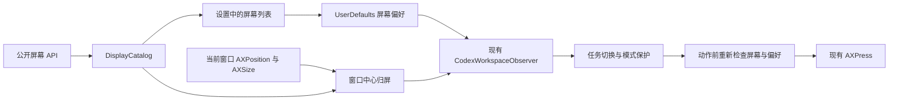

# 按屏幕选择自动展开 Codex 右侧工作区

- 作者：Longbiao CHEN
- 日期：2026-11-10（Asia/Shanghai）
- 状态：Longbiao 于 2026-11-10 批准；已实施安装版 0.2.0，现场验收见 `docs/acceptance.md`
- 源码基线：`cc28fe5`，规范 checkout `/Users/longbiao/Projects/codex-plus`
- 范围：设置、偏好持久化、自动展开条件与只读诊断

## 1. 问题与目标

Codex Plus 当前在 Codex 模式新建或切换任务时，展开已收起的右侧工作区。用户希望按屏幕决定自动展开：在设置中看到实际屏幕，选择适用屏幕后保存生效。不同屏幕的可用空间和用途不同，全局开关缺少这种控制。

本方案增加屏幕多选。判定对象为当前 Codex 窗口所在屏幕。选中屏幕上的新建／切换任务沿用现有展开行为；其他屏幕保留工作区当前状态。屏幕设置只控制自动展开动作。

成功标准：保存后持续使用所选屏幕；重启应用后保留选择；屏幕断开、重连与布局变化时有明确行为；当前任务的手动收起、已有标签页、ChatGPT 模式与弹窗保护沿用现有规则。

设计已获批准，开发、安装和真实验收分别记录于项目验收文档。历史迁移事项 Issue #1 仍按原验收状态跟踪。

## 2. 当前事实与参考实现

### Codex Plus

- `Sources/CodexPlus/CodexPlusApp.swift`：单页 SwiftUI 设置，`workspaceAutoExpand` 全局偏好，修改开关时通过回调重启观察器。
- `Sources/CodexPlusCore/CodexWorkspacePolicy.swift`：通过窗口与工具栏的 AX 身份跟踪任务切换；启动附着已有任务时建立基线；重复事件和当前任务手动收起维持原状。
- `Sources/CodexPlusCore/CodexWorkspaceObserver.swift`：结构与 header 范围读取；动作前重新检查窗口、任务、模式、按钮、权限与全局开关；已有 150 ms 事件合并。
- 2026-11-10 只读状态：安装版 0.1.0，辅助功能已授权，观察器运行，全局自动展开已开启。目标 PID 的可执行文件位于 `/Applications/ChatGPT.app`，版本为 26.1103.60933（25894）；观察器使用 bundle identifier `com.openai.codex` 发现目标，公开模式为 `codex`。

### Dock Switch 中采用的部分

| 源文件 | 已有实现 | 本方案的使用方式 |
| --- | --- | --- |
| `native/dock-switch-app/Sources/DockSwitchCore/DockSwitchCore.swift` 的 `DisplayService.displays()` | 从 `NSScreen.screens` 获取运行时 display ID、名称、内外屏、bounds、缩放 | 在 Codex Plus 内实现小型原生采集器，保持相同字段来源 |
| 同文件 `DisplayGeometry.display(containing:displays:)` | 以窗口中心确定屏幕，并在屏幕间隙回退到最近屏幕 | 采用窗口中心归屏；中心落在间隙时返回未知，等待下一次任务事件 |
| `native/settings-app/Sources/Models.swift`、`SettingsRootView.swift` | Picker 绑定设置；屏幕选项是内屏／外屏／左右屏等角色 | 沿用原生设置交互；新列表使用实际连接屏幕，支持多选 |
| `src/control-server.js`、`bin/dock-switch-cli.js` | `displays` 只读列出屏幕及其几何信息 | 用于设计阶段核对当前屏幕；产品运行时由 Codex Plus 自行采集 |

Dock Switch 的外屏离线回退服务于窗口放置；本功能按所选屏幕精确授权动作，离线条目保留选择，其他屏幕维持各自状态。两项目独立运行，Codex Plus 独占工作区观察器。

### 已验证的身份识别可行性

本机四块屏幕包含两台同型号外屏。使用公开 `CGDisplayVendorNumber`、`CGDisplayModelNumber`、`CGDisplaySerialNumber` 的组合会让这两台屏幕得到相同键。

公开 ColorSync 头文件 `ColorSyncDevice.h` 声明了 `CGDisplayCreateUUIDFromDisplayID`。使用 `import ColorSync` 的临时 Swift 探针成功编译并运行，四个在线屏幕各自返回唯一 UUID。探针只输出“是否可用／重复数量”，硬件序列号与 UUID 原文保留在进程内部。因此本方案采用 ColorSync UUID 持久化选择。

这项探针覆盖当前在线拓扑；重连、系统重启与换插口的稳定性列入真实验收。系统生成新 UUID 时展示旧选择为离线，新屏幕由用户选择。

## 3. 产品行为

### 设置

现有“自动展开 Codex 工作区”总开关继续保留。下方增加“适用屏幕”：

```text
自动展开 Codex 工作区                           [开启]

适用屏幕                 (● 所有屏幕  ○ 所选屏幕)
选择后自动保存；在下一次新建或切换任务时应用。

☑ 内建显示器                  内屏 · 1512 × 982 pt
☑ 外接显示器 A                外屏 · 2560 × 1440 pt
☐ 外接显示器 B                外屏 · 1080 × 1920 pt
☑ 外接显示器 C                外屏 · 已断开

当前 Codex 窗口：外接显示器 A · 允许自动展开
```

上图为“所选屏幕”交互示意。实际名称与尺寸来自当前运行时。

- “所有屏幕”是升级与首次启动默认值，沿用现有行为；列表显示在线屏幕且勾选，行选择控件置灰。
- 第一次切换到“所选屏幕”时，默认勾选当时身份可用的在线屏幕。此后切换两种模式保留上次自选集合。
- “所选屏幕”允许多选和空集；空集显示“当前未选择屏幕，自动展开已暂停”。后续接入的新屏幕初始为未选。
- 每次模式或勾选变化立即存储并更新运行中的判断条件；用户在当前任务中继续操作时，工作区保持当前状态。后续新建／切换任务使用新设置。
- 总开关关闭时屏幕配置保留，区域置灰。总开关重新开启沿用现有的附着基线语义。
- 在线行按内屏优先、其余按 `bounds.minX`、`bounds.minY`、UUID 排序；离线的已选行放在末尾。屏幕同名时增加当前方位和 UUID 的末 6 位供区分；完整 UUID 仅用于内部匹配。
- 离线已选条目保持勾选并允许取消；取消后从离线列表移除。在线未选屏幕只保留实时行。
- UUID 获取失败或出现重复的行显示“屏幕身份暂不可用”，在自选模式中置灰；该行在所有屏幕模式下沿用原有全局行为。
- 设置窗口改为可调整大小的滚动内容，初始内容区 560 × 520 pt；保留权限、登录启动与错误提示。设置打开期间热插拔自动刷新列表。

### 行为表

| 条件／事件 | 结果 |
| --- | --- |
| 总开关关闭 | 观察器沿用当前停止动作行为，屏幕配置保留 |
| 所有屏幕模式 | 沿用现有自动展开判断与启动语义 |
| 自选模式，任务发生切换且窗口中心属于已选屏幕 | 已收起时展开一次，已展开时保留标签页 |
| 自选模式，窗口在未选屏幕／未知屏幕／身份异常屏幕 | 记录任务基线，跳过动作，保留工作区当前状态 |
| 当前任务手动收起 | 当前任务保持收起 |
| 同一任务移到另一块屏幕 | 保留当前状态；下一次任务切换按移动后的屏幕判断 |
| 修改屏幕选择／热插拔／改变分辨率与排列 | 更新屏幕条件与状态显示；当前任务保持当前状态 |
| 目标屏幕断开 | 原选择保留为离线，已选集合保持；其他屏幕分别按自身选择处理 |
| 目标屏幕以相同 UUID 重连 | 在线列表恢复选中；后续任务事件恢复适用 |
| ChatGPT 模式／对话框／结构未知 | 沿用现有模式与结构保护 |
| 镜像显示 | 按 `NSScreen.screens` 暴露的逻辑屏幕列出；若多个逻辑候选的 bounds 同时包含中心，自选模式跳过并显示“屏幕归属有歧义” |

产品决策采用“屏幕条件过滤已有任务触发”。自动收起和跨屏移动即展开留在后续独立需求范围，便于保持手动操作语义。

## 4. 技术设计



### 4.1 数据与持久化

在现有 `me.longbiaochen.codex-plus` 偏好域增加单个 `workspaceAutoExpandDisplaySelection` Data 值，以 Codable JSON 编解码。保留已有 `workspaceAutoExpand` Bool。

| 字段 | 类型 | 约束 |
| --- | --- | --- |
| `version` | Int | 当前为 1 |
| `mode` | String | `all` 或 `selected` |
| `hasCustomSelection` | Bool | 区分首次进入自选与用户保存的空集 |
| `selectedDisplays` | Array | 每项为 `uuid: String`、`lastKnownName: String`；按 UUID 去重排序 |

存储只保存已选项。`lastKnownName` 在一次用户配置保存时更新，用于离线显示；几何、缩放、运行时 display ID 均从当前系统采集。默认键缺失时得到 `all / false / []`，保持现有安装的行为。

屏幕键读取类型错误、新键解码失败、未知 schema 版本或非法字段，均在自选配置入口呈现“屏幕设置读取失败，请重新选择”，停止屏幕自选动作并保留原始值。设置提供“重设屏幕选择”按钮，明确写入默认配置；用户也可直接选择模式和屏幕以替换错误值。应用启动时保留全局开关原有默认规则。

所有设置与观察器状态变更在主线程串行执行。屏幕配置发生实际变化时调用 `displaySelectionDidChange()`：取消已有 pending 检查并递增 generation，更新偏好与屏幕状态，按 §4.3 同步消费当前任务、建立基线，保留订阅与动作计数。相同值重复保存维持原状态。由 `UserDefaults` 负责偏好存储；保存路径覆盖应用重启验收。持久化失败通过应用重启后的真实读回发现并修复。

### 4.2 DisplayCatalog 与屏幕归属

新增 `CodexWorkspaceDisplay.swift`，包含纯数据、纯判断和原生采集器，均置于 Core target。

- `CodexWorkspaceDisplay` 保存当前 `displayID: UInt32`、`uuid: String?`、`name: String`、`isBuiltin: Bool`、`bounds: CGRect`、`scaleFactor: Double`、`identityUsable: Bool`。
- `CodexWorkspaceDisplayCatalog.refresh()` 从 `NSScreen.screens`、`NSScreenNumber`、`localizedName`、`CGDisplayIsBuiltin`、`CGDisplayBounds`、`backingScaleFactor`、ColorSync UUID 构造同一代快照。重复 UUID 的所有对应行标记身份异常。
- 在 app 启动、设置打开和 `NSApplication.didChangeScreenParametersNotification` 时刷新；设置视图订阅 catalog 发布值。观察器动作前再采集一次，覆盖刷新与动作之间的变化。采用系统事件与已有检查路径，持续 AX 树轮询范围维持现状。
- `CodexWorkspaceDisplayPolicy.resolve(windowFrame:displays:)` 检查有限数值、正尺寸，以 AX 窗口 rect 中心匹配 `CGDisplayBounds`。使用左／上闭、右／下开区间，边界匹配规则确定。唯一候选返回该屏幕；零候选为 `unknownDisplay`，多个候选为 `ambiguousDisplay`。
- AX 的 `AXPosition` 和 `AXSize` 是屏幕全局坐标中的 pt；`CGDisplayBounds` 使用主屏左上角原点的全局屏幕坐标。两者直接比较，涵盖负坐标、上下排列和混合缩放；完整屏幕 bounds 用于归属，workArea 用于展示或放置时才有意义。
- 单独的判断 `allows(selection:resolvedDisplay:)` 在 `all` 模式沿用现有全局行为，在 `selected` 模式要求身份唯一有效且 UUID 在集合中。

### 4.3 观察器接入与动作时序

`Sample` 增加窗口几何读取结果。只对当前 focused standard window 读取公开 `AXPosition`、`AXSize`；会话内容、编辑框、侧栏列表与嵌套网页的既有裁剪维持现状。

1. 由现有 `sampleForInspection()` 获得识别成功的 Codex 任务。
2. 始终先调用 `tracker.observe(...)` 更新任务基线，再判定屏幕是否允许动作；位于未选屏幕的任务同样参与跟踪。
3. 缺少任务切换、工作区已展开、缺少按钮或屏幕条件失败时结束。屏幕读取失败时，自选模式跳过，所有屏幕模式沿用原有判断。
4. `AXPress` 前重新获得 current sample、当前屏幕快照和当前偏好。复用现有窗口、工具栏、关闭状态、按钮身份、按钮 enabled、全局开关和权限检查；自选模式还要求当前窗口中心解析为同一块已选屏幕。任意条件改变则消费本次切换事件，等待后续真实任务切换。
5. 执行现有单次 `AXPress`，保留动作返回值和计数语义。未知动作结果继续沿用当前处理路径。

跨屏移动和显示器变化负责更新查询结果；任务切换仍由原 tracker 唯一判断。

`seedOnlyAfterDisplaySelectionChange` 封装在现有 tracker 中并初始化为 false，归属于当前一次观察器附着生命周期；`detach()` 通过 tracker reset 与 pending 一并清为 false，涵盖总开关关闭、权限撤销、目标进程终止与重新附着。弹窗与未知结构使用保留该标记的 `invalidateView()`。总开关关闭、权限缺失或尚未附着目标进程时，保存屏幕配置只更新偏好与屏幕列表；由后续正常附着沿用原启动基线规则。

观察器已附着且全局开启、权限有效时，屏幕配置修改需要消费刚发生但仍在 150 ms 合并等待中的任务切换。`displaySelectionDidChange()` 取消 pending 后设置 `seedOnlyAfterDisplaySelectionChange = true`，同步执行一次受现有模式／结构保护的 snapshot：

- `.chat`：调用 `tracker.observe(window:chat:workspaceOpen:)` 并忽略返回动作意图，更新当前 pane 状态，清除一次性标记。
- 明确的 `.outside` 或 `.chatGPT`：调用 `tracker.startOutsideChat()` 并清除标记，后续真正打开 Codex 任务可正常触发。
- `.modal`：沿用弹窗观察与 tracker reset，保持标记。
- `.unknown`：保持标记，当前动作跳过。

后续 `inspect()` 在正常切换逻辑前检查该标记；标记存在时，第一份成功识别的 `.chat` 样本只建立基线并清除标记。遇到明确 `.outside`／`.chatGPT` 时按上面的规则处理，弹窗与未知状态继续等待。此过程沿用模式、结构与权限保护。即使当前样本暂时不可读，也会优先保留当前任务状态，下一次真正任务切换恢复动作。

### 4.4 只读状态

扩展现有 `workspace` 状态对象，旧字段保持：

- `displaySelectionMode`: `all / selected / invalid`。
- `selectedDisplayCount`、`connectedSelectedDisplayCount`。
- `focusedDisplayName`: 当前 focused Codex window 对应屏幕的显示名，未知时省略。
- `displayEligible`: Bool，未知或异常在自选模式下为 false；所有屏幕模式为 true。
- `displayDecision`: `allDisplays / selectedDisplay / unselectedDisplay / noSelection / unknownDisplay / ambiguousDisplay / unavailableIdentity / invalidPreference / unavailableWindow`。

通过状态读取即时刷新当前 focused window 的公开几何与 catalog，计算诊断结果；此路径保持只读，维持 tracker、AXPress 与动作计数。状态含义与最后一次展开动作分开：`displayDecision` 描述当前条件，`lastPressResult` 描述最近动作。

状态命令和日志省略完整 UUID、硬件序列号、聊天标题和正文。界面与本机只读状态使用屏幕名称；公开验收报告将机器特有名称脱敏。

## 5. 实施边界与步骤

后续开发由当前 Codex Plus 项目执行，Longbiao 审阅设计与最终产品行为；Dock Switch 作为只读参考。

| 阶段 | 文件范围 | 交付与检查 |
| --- | --- | --- |
| 1. 屏幕数据与偏好 | 新增 `Sources/CodexPlusCore/CodexWorkspaceDisplay.swift`；修改 `Sources/CodexPlusCore/CodexWorkspacePolicy.swift`；新增 `Tests/CodexPlusCoreTests/CodexWorkspaceDisplayTests.swift` | 确定性几何、身份匹配、偏好编解码与默认升级行为，通过 Core 测试 |
| 2. 设置和运行接入 | 修改 `Sources/CodexPlus/CodexPlusApp.swift`、`Sources/CodexPlusCore/CodexWorkspaceObserver.swift`、`AppInfo.plist`；修改 `Tests/CodexPlusCoreTests/CodexWorkspacePolicyTests.swift`；扩充 DisplayTests | 设置列表、热插拔刷新、屏幕过滤、任务 tracker 连续性、动作前复核、状态字段；发布版本 0.2.0（2），保持可构建 |
| 3. 文档与真实验收 | 修改 `README.md`、`docs/acceptance.md`、本设计文档 | 运行既有测试、单次签名构建、安装并按下一节验收；记录候选、签名、安装身份和证据 |

复用系统 AppKit、CoreGraphics、ColorSync 与 Foundation；Swift Package target 保持现状，公开模块通过 Swift 链接。实现时若系统模块链接确需显式配置，只在 `Package.swift` 添加对应系统 framework 链接。`Sources/CodexPlus/StatusChannel.swift` 的传输与只读权限保持现有实现。

### 新增限制

增加一个用户配置的动作条件：自选模式只在已选屏幕展开。默认 `all` 保留现状；资源并发和轮询时序沿用当前配置。实现 PR 的“新增限制”节列出上述入口、默认值与用户需求依据，按仓库负责人定稿要求办理。

## 6. 验证与验收

### 自动测试

1. 键缺失迁移到所有屏幕；旧全局开关值保留；自选配置与屏幕名称可往返编解码。
2. 初次进入自选勾选当前可用屏幕；用户保存空集后，模式往返与应用重启仍为空集。
3. 两台同名／相同 vendor-model-serial 屏幕，通过不同 ColorSync UUID 分别控制。
4. UUID 缺失、重复、格式错误与偏好 schema 错误进入明确定义的状态；原始错误偏好保留到用户重设。
5. 窗口中心归属覆盖内外屏、负坐标、竖屏、上下排列、混合缩放、跨屏窗口、精确边界、屏幕间隙、重叠 bounds 和无效 rect。
6. 自选允许／拒绝后 tracker 都更新：在未选屏幕切换任务、移动同一任务至已选屏幕再收到重复事件，动作计数保持；随后真实切换任务触发一次。
7. 基线 A → B 已排队但尚未 inspect → 修改屏幕选择 → 同步消费 B → B 重复事件，动作次数保持；随后 B → C 按新设置触发一次。另测修改时 sample 为 unknown／modal，恢复 B 后只建立基线；明确 Home／ChatGPT 后新开 Codex 任务可正常触发。相同值重复保存维持 pending 与 tracker 原状态。生命周期断言包括：总开关关闭 → 修改选择 → 开启并附着 B → B 重复事件维持 → B → C 触发一次；unknown 留标记 → 目标退出清标记 → 重启后沿用正常新开任务行为；权限撤销和重新附着同样清理标记。
8. 动作前窗口移动到另一屏、屏幕断开、选择变化、按钮变化、模式变化或权限变化，均跳过该次动作。
9. 屏幕选择对已展开工作区、手动收起、启动附着、ChatGPT、Rename 和重复事件的既有断言继续通过。
10. 状态查询的当前屏幕与决策原因更新，tracker 和 pressCount 保持；新增字段的值覆盖全部原因。

通过注入屏幕快照、偏好与 frame 读数测试判断；测试保持单元与进程内范围。真实设备行为使用安装版验收。

### 安装版场景

| 场景 | 可观察结果 |
| --- | --- |
| 打开设置 | 当前连接的屏幕均有行；同名可分辨；多屏内容可滚动 |
| 仅选一块外屏 | 所选屏幕上的真实 ⌘N 和任务切换展开一次；其他屏幕保持已收起状态 |
| 已展开任务移至未选屏幕 | 已有 pane 与标签页保留 |
| 当前任务手动收起后移屏／改选择 | 当前任务继续收起；随后在已选屏幕切换任务展开 |
| 空集、所有屏幕、总开关关闭／恢复 | 分别符合产品行为表；选择保存且状态字段一致 |
| 退出并重新启动 Codex Plus | 模式和每块屏幕选择保持，已有任务按启动基线处理 |
| 拔插已选外屏 | 离线条目保留、其他屏幕维持各自选择；相同 UUID 重连后恢复勾选 |
| 重启电脑／换插口 | 分别核对同型号屏幕身份；UUID 改变时旧选择显示离线，新屏幕保持未选并提示重新选择 |
| 调整排列、缩放和分辨率 | 选择继续跟随 UUID；后续任务按实际窗口中心归属判断 |
| 镜像模式 | 列表与逻辑屏幕对应；归属有歧义时跳过动作并给出原因 |
| ChatGPT 模式、Rename、已展开任务 | 原有保护与标签页保持通过 |

候选绑定记录位于 `~/Library/Logs/codex-plus/`，构建缓存位于 `~/Library/Caches/codex-plus/`。保留旧安装版用于回退；单 runtime 与原辅助功能授权沿用。最终运行现场恢复正常配置，Issue 的产品验收以 Longbiao 接受结果为准。

## 7. 备选方案与取舍

| 方案 | 机制 | 取舍与本次选择依据 |
| --- | --- | --- |
| 实际屏幕 UUID 多选（采用） | 动态列出设备并保存 ColorSync UUID | 支持逐屏控制及同型号区分；系统身份改变时需要重新选择 |
| Dock Switch 角色选项 | 保存内屏／外屏／左右屏 | 配置紧凑；外屏数量和排列改变时角色对应设备会变化，逐屏多选意图更适合实际设备 |
| 按分辨率或窗口宽度自动决定 | 设阈值推断可用空间 | 可随窗口尺寸变化；引入阈值产品决策，覆盖范围偏离用户指定屏幕的意图 |
| 按窗口与屏幕最大交叠面积归属 | 计算每个屏幕交叠面积 | 大跨屏窗口的多数面积语义明确；窗口中心归属便于沿用 Dock Switch 的行为解释 |
| 移屏立即展开并在其他屏幕收起 | 监听移动并持续调节 pane | 自动布局覆盖更广；需要另行定义手动收起、标签页与移动时机的优先级 |

## 8. 风险、成本与回退

- 屏幕 UUID：当前四屏唯一性已验证。重连、重启和换口按验收矩阵验证；新 UUID 始终作为新设备处理，离线选择保留。
- 几何瞬态：移动、热插拔和弹窗期间可能读取失败。自选模式跳过该次动作并报告原因，后续任务切换重新判断。
- 镜像：macOS 暴露逻辑显示器，界面按逻辑屏幕表达；几何多解跳过。
- 设置存储：使用应用现有 UserDefaults 域与一个版本化值；配置损坏时呈现恢复入口。旧版应用忽略新键，原总开关继续生效。
- 隐私与权限：新增读取限于当前窗口公开几何及系统显示器元数据，沿用现有辅助功能权限。运行时只在本机执行；网络服务、后台模型调用和新权限需求为零。
- 成本：采集和判断随当前屏幕数线性增长；每次动作前的一次额外屏幕枚举，无新增定时器。设置只持久化所选 UUID 与显示名，规模随所选屏幕数增长。
- 回退：用户选择“所有屏幕”恢复当前产品语义；总开关可暂停动作。安装回退沿用原安装版备份和单观察器规范，新键保留供后续版本识别。

## 9. 参考资料

- 项目 [README](../../README.md) 与 [验收](../acceptance.md)。
- Dock Switch 上述源文件，以本地规范 checkout 为参考；本次设计仅执行只读查询。
- Apple：[NSScreen](https://developer.apple.com/documentation/appkit/nsscreen)、[CGDisplayBounds](https://developer.apple.com/documentation/coregraphics/cgdisplaybounds(_:))、[显示器配置变化通知](https://developer.apple.com/documentation/appkit/nsapplication/didchangescreenparametersnotification)。
- Apple：[CGDirectDisplayID 生命周期](https://developer.apple.com/documentation/coregraphics/cgdirectdisplayid)。运行时 display ID 的生命周期说明支持将 UUID 单独保存为选择键。
- 当前 macOS SDK 的公开 `ColorSync.framework/Headers/ColorSyncDevice.h`、`CoreGraphics.framework/Headers/CGDisplayConfiguration.h`、`ApplicationServices.framework/Frameworks/HIServices.framework/Headers/AXAttributeConstants.h`，分别核对 UUID API、display 几何与 AX 坐标单位。
